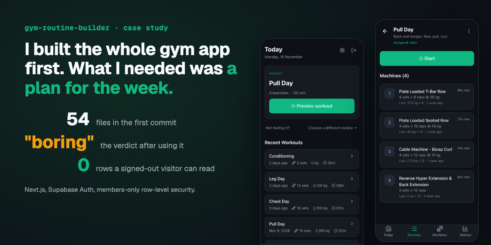
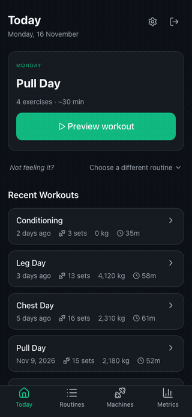
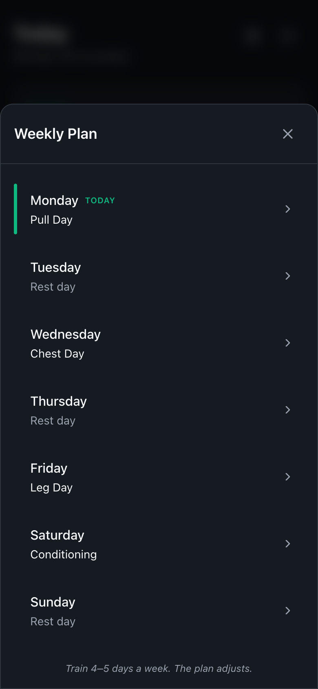
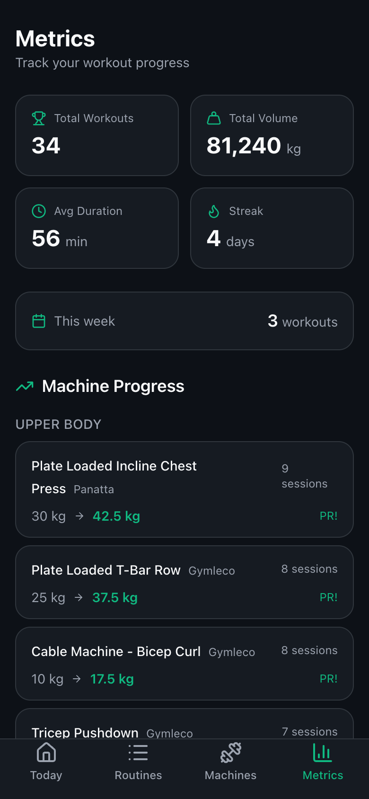
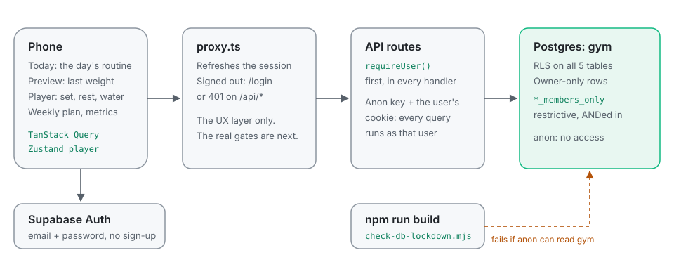
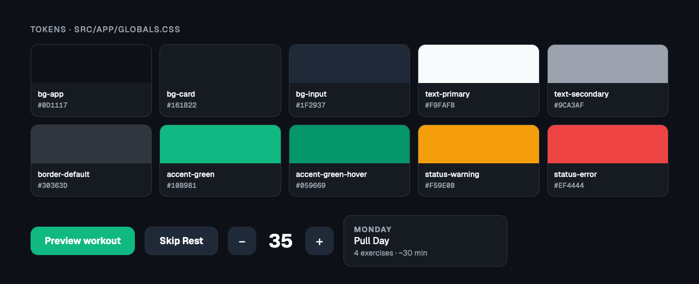

# gym-routine-builder

**A gym app that plans the week and shows last time's weight.**

[](#what-it-does)
[](https://github.com/AIwithDiego/gym-routine-builder/actions/workflows/ci.yml)


[](LICENSE)

[](#what-it-does)

A case study. A mobile web app I built for myself with Claude Code between February and September 2026, in Dublin. It started as too much app and ended smaller and locked down.

**[See it run](#what-it-does)** (sample data, nothing real) · [What went wrong](#what-went-wrong) · [Run it yourself](#run-it-yourself)

**Contents:** [The problem](#the-problem) · [Research](#research) · [What it does](#what-it-does) · [The build](#the-build) · [Design system](#design-system) · [What went wrong](#what-went-wrong) · [What I learned](#what-i-learned) · [Run it yourself](#run-it-yourself)

## The problem

I train on machines. Between sets I kept losing two things: the weight I used last time on each machine, and which routine was due that day. Notes apps don't time rest periods.

So I wrote a spec and had Claude Code build the whole thing in one go: routine builder, guided workout player, rest timer, history, later metrics and cardio. It worked. After a stretch of using it, my own word for it was "boring". It logged everything and planned nothing. Nothing told me what today was for, or what I had to beat.

> I built a complete workout log. What I needed was a week with a shape and last time's number in front of me.

## Research

**What already exists.** Notes apps hold numbers but don't time rest or know what's due. Workout apps log sets well; what I was missing was a week with a plan in it and last time's weight in front of me, and a log alone doesn't give you that.

**Who it's for.** One person training on machines, phone in hand between sets. That meant 44 px touch targets, a dark screen, one action per screen, and weight that moves in 2.5 and 5 kg steps instead of a keyboard.

**The limits we chose.**
- **Machines only.** A fixed catalogue of the machines in one gym, with brand, description and a how-to video link. No free weights, no exercise library.
- **One routine per weekday.** The weekly plan is the single source of truth. Assigning a day that's taken asks before it switches.
- **Today follows the phone.** Weekdays are stored as 0 (Sunday) to 6, the convention JavaScript and Postgres share, and "today" is worked out on the device.
- **History outlives routines.** Deleting a routine keeps the workouts logged against it.
- **Members only.** No public sign-up. An operator adds people in SQL.

**What I didn't build.** Periodised programmes (blocks, deloads) were too much surface for one user and got parked. A big batch of new routines was the cheap fix I almost shipped instead of the weekly plan; four were added anyway, and they weren't what changed the app.

## What it does

The app opens on Today: the routine planned for this weekday, how long it should take, and a way out if you're not feeling it. Preview shows every machine with the weight and reps you did last time. Start runs the workout one set at a time: work set, rest timer, a water reminder between machines, then a summary.

| Screen | What it does |
|---|---|
| Today | The routine due today, recent workouts, resume an unfinished one |
| Weekly plan | One routine per weekday, Monday first; a confirmation when a day is taken |
| Preview | Each machine with sets, reps, rest and last time's weight |
| Workout player | Weight in 2.5 kg steps, rest timer you can pause or stretch, reorder machines mid-workout |
| Metrics | Totals, this week, streak, first-to-latest weight per machine |
| Machines | The gym's catalogue with a how-to video per machine |

<table>
<tr>
<td width="33%"></td>
<td width="33%"></td>
<td width="33%"></td>
</tr>
<tr>
<td>Today, preview, one set, rest.</td>
<td>The week has a shape.</td>
<td>Progress per machine.</td>
</tr>
</table>

The live app is members only and holds real training logs, so there's no public demo. These captures are the real UI running locally with the sign-in proxy removed and every API call answered from sample data: [`docs/src/capture.py`](docs/src/capture.py) and [`docs/src/demo_data.py`](docs/src/demo_data.py).



1. **Screens** (`src/app/(tabs)/`, `src/app/workout/[sessionId]/`): client components. TanStack Query for server data, a Zustand store for the player (`idle`, `working`, `resting`, `hydrating`, `summary`) in `src/stores/workout-player.ts`.
2. **Proxy** (`src/proxy.ts`): refreshes the Supabase session cookie, sends signed-out visitors to `/login` and answers `/api/*` with 401. It's the UX layer.
3. **Route handlers** (`src/app/api/`): each one calls `requireUser()` from `src/lib/supabase/server.ts` first, then queries as that user with the public key and their cookie. No service-role key anywhere under `src/`.
4. **Database** (`supabase/schema.sql`): five tables in a `gym` schema. Row-level security on all of them, one policy per operation, owner-only rows, and a restrictive `*_members_only` policy that Postgres ANDs into every other policy. Two RPCs: one writes the weekly plan in a single transaction, one returns last-used weight per machine.
5. **Build guard** (`scripts/check-db-lockdown.mjs`): runs before `next build` on the host and fails the deploy unless the anonymous role is denied on `gym` and the members gate exists.

## The build

All of it built with Claude Code, from Opus 4.5 in February to Opus 4.7 in June. From June the bigger changes went through a product review and a three-agent design review first (UX, architecture, QA), each writing its own doc before any code. The working repo is private; this public copy starts at the release, so the table lists milestones and links to the files that hold them.

| When | What landed | Where it lives now |
|---|---|---|
| 4 Feb 2026 | The whole first version in one commit (54 files) from a written spec and UX doc: routine builder, workout player, rest timer, a Build tab | `src/app/`, `src/stores/workout-player.ts` |
| 6 to 7 Feb | Water reminder between machines, kilograms instead of pounds, workout history on Today, an agent guide for Claude Code | `src/components/workout/hydration-reminder.tsx`, [`CLAUDE.md`](CLAUDE.md) |
| 23 to 27 Mar | Build tab swapped for Metrics, seed scripts, cardio, reordering machines mid-workout | `src/app/(tabs)/metrics/`, `scripts/` |
| 24 Apr | Two date bugs: workouts showing on the wrong day because of the timezone offset | `src/lib/utils.ts` |
| 4 Jun | After "boring": weekly plan, a Today screen that knows the day, and a preview with last weight. Product review, design docs and an 88-case test matrix first, then one PR (23 files) | `supabase/migration_add_weekly_plan.sql`, `src/components/routines/weekly-plan-sheet.tsx` |
| 7 Sep | Moved to its own `gym` schema in a shared Supabase project | `supabase/schema.sql` |
| 23 Sep | Supabase Auth, row-level security, the members gate and the build guard; the service-role key out of every request path and rotated | [`supabase/launch/`](supabase/launch/), [`docs/launch-checklist.md`](docs/launch-checklist.md) |
| 24 Sep | Public release, CI with gitleaks, Dependabot grouped ([#8](https://github.com/AIwithDiego/gym-routine-builder/pull/8)) | [`.github/`](.github/) |

## Design system

Short version: one dark theme, ten tokens, a handful of primitives. Designed for a phone held one-handed in a gym.



### Principles
| | |
|---|---|
| **One action per screen** | The player shows one set and one big button. Rest shows one timer. |
| **Preview before start** | Routine cards lost their play button: you always see the machines and last weights first. |
| **Last time is the target** | The number to beat sits next to each machine, so progress is a decision you make in the moment. |
| **Thumbs, not keyboards** | 44 px targets, steppers in 2.5 and 5 kg, bottom navigation, no typing mid-workout. |

### Tokens
Defined once in [`src/app/globals.css`](src/app/globals.css) as CSS custom properties and mapped into Tailwind v4 (`bg-bg-card`, `text-accent-green`).

| Token | Value | Use |
|---|---|---|
| `bg-app` / `bg-card` / `bg-input` | `#0D1117` / `#161B22` / `#1F2937` | Page, cards, controls |
| `text-primary` / `text-secondary` | `#F9FAFB` / `#9CA3AF` | Body, meta |
| `border-default` | `#30363D` | Card and sheet borders |
| `accent-green` / hover | `#10B981` / `#059669` | Primary actions, today, progress |
| `status-warning` / `status-error` | `#F59E0B` / `#EF4444` | Resume, delete |

### Components
`Button`, `Card`, `Input`, `Modal`, `NumberStepper`, `EmptyState`, `Loading` in [`src/components/ui/`](src/components/ui/); the player screens in `src/components/workout/`.

### Accessibility, measured
WCAG contrast ratios from the token values:

| Pair | Ratio | AA |
|---|---|---|
| Body text on page / card | 18.1 / 16.6 | pass |
| Secondary text on page / card | 7.5 / 6.8 | pass |
| Green text on page / card | 7.5 / 6.8 | pass |
| White label on green button | **2.4** | **fails** (see below) |
| Page-coloured label on green button | 7.5 | pass |

## What went wrong

| | Fix |
|---|---|
| **I built the app before I knew the job.** The first version did everything I wrote in the spec and still felt like homework. The job was "know what today is for and beat last time", and the log never said either. | Weekly plan and preview: [`migration_add_weekly_plan.sql`](supabase/migration_add_weekly_plan.sql), [`weekly-plan-sheet.tsx`](src/components/routines/weekly-plan-sheet.tsx) |
| **"The key is server-only" doesn't mean the data is safe.** v1 had no login. Every API route used the service-role key, row-level security was off and the anonymous role had full grants, so anyone who found the routes could read, change or delete the data. The key never reached the browser; the server was the open door. | [`01_lockdown.sql`](supabase/launch/01_lockdown.sql), [`server.ts`](src/lib/supabase/server.ts) |
| **Signed in isn't the same as allowed.** Login and RLS stopped strangers reading my rows. Neither stopped a stranger making an account. | [`02_members.sql`](supabase/launch/02_members.sql) |
| **A fix deployed early would have widened the hole.** The auth build ships a public key to the browser; deployed before the database was locked down, that key would have opened it. | [`check-db-lockdown.mjs`](scripts/check-db-lockdown.mjs) |
| **Deleting a used routine failed.** A foreign key with no delete rule blocked it, and the right answer was to keep the history anyway. Found by the QA review, not by me. | [`migration_add_weekly_plan.sql`](supabase/migration_add_weekly_plan.sql), later [`03_fk_set_null.sql`](supabase/launch/03_fk_set_null.sql) for logged sets |
| **Abandoned workouts never ended.** Testing the Resume screen found 10 sessions still "in progress", the oldest months old, which would have shown as "640 min in". Sessions older than 12 hours now close themselves. | [`in-progress/route.ts`](src/app/api/workouts/in-progress/route.ts) |
| **A late workout showed up as tomorrow's.** Relative dates compared milliseconds, not calendar days. | [`utils.ts`](src/lib/utils.ts) |
| **`startsWith("/")` is not URL validation.** Browsers treat `\` like `/`, so `/\evil.example` after sign-in is an off-site redirect. | [`safe-next.ts`](src/lib/safe-next.ts) and [its tests](src/lib/safe-next.test.ts) |
| **The main button fails contrast.** White on `#10B981` measures 2.4:1. The design review asked for it to be checked, and it shipped without the check. Still open: the fix is a page-coloured label (7.5:1). | Open: [`button.tsx`](src/components/ui/button.tsx) |

## What I learned

- **Use it before you add to it.** A week of real use told me more than the 400-line spec. The fix was three screens, not thirty features.
- **Find the job, then the feature.** "Boring" sounded like a content problem (more routines). It was structural: no week, no target.
- **Authentication, authorisation and membership are three separate locks.** Each one stopped a different person.
- **Make the order of operations a failing build.** "Run the SQL before you deploy" was a checklist line until the build refused to ship without it.
- **Reviews catch what using it doesn't.** The delete bug and the contrast risk came from the design review, and the stale sessions from checking the preview build, not from training with the app.

**What's next:** last time's weight on the work-set screen with a moment when you beat it, swapping a machine mid-workout, and the dark label on the green button.

## Ground rules

- **No public sign-up.** People are added by an operator, in SQL.
- **The database decides.** Every rule that matters is a Postgres policy; the app is the second layer.
- **No service-role key in the app.** It exists only for local seed scripts in `scripts/`.
- **Sample data only in this repo.** The screenshots and seed scripts use made-up routines and numbers.

## Run it yourself

You need Node 22 and a Supabase project of your own.

1. `npm ci && cp .env.example .env.local`, then fill in the two `NEXT_PUBLIC_` values.
2. In the Supabase SQL editor, run [`supabase/schema.sql`](supabase/schema.sql), then add `gym` to the exposed schemas (Project Settings > API).
3. Create your user (Authentication > Users > Add user), then make it a member: `insert into gym.members (user_id) select id from auth.users where email = '<your email>';`
4. `npm run dev` and sign in at http://localhost:3000.
5. Checks: `npm run lint && npx tsc --noEmit && npm test && npm run build` (`CHECK_DB_LOCKDOWN=1` runs the lockdown probe locally).

Moving an existing, pre-auth database without a window where data is exposed: [`docs/launch-checklist.md`](docs/launch-checklist.md).

## Repo map

```
src/app/(tabs)/            Today, Routines, Machines, Metrics (bottom nav)
src/app/workout/           the full-screen workout player
src/app/api/               route handlers; requireUser() first in each
src/proxy.ts               session refresh, /login redirect, 401 on /api/*
src/lib/supabase/          server client (anon key + cookie), browser client, env
src/lib/safe-next.ts       same-origin check for ?next= after sign-in, with tests
src/stores/                the workout player state machine
supabase/schema.sql        fresh setup: tables, RLS, members gate, RPCs, machine catalogue
supabase/launch/           ordered, idempotent migrations for an existing database
scripts/                   lockdown probe (runs before build) and local seed scripts
docs/                      launch checklist, diagram, README images; docs/src/ draws them
CLAUDE.md                  the guide Claude Code reads before changing anything
```

## Credits

Built with [Claude Code](https://claude.com/claude-code). Machine catalogue entries link to public how-to videos on YouTube. Stack: Next.js, React, Supabase, TanStack Query, Zustand, Tailwind CSS, dnd-kit, Framer Motion and Lucide icons.

## Licence

MIT · Made in Dublin by [Diego Bauer](https://www.aiwithdiego.com) · [LinkedIn](https://www.linkedin.com/in/diego-bauer-domeyko/)

Built by [AIwithDiego](https://www.aiwithdiego.com). Need something like this for your team? [Talk to me](https://www.aiwithdiego.com).
